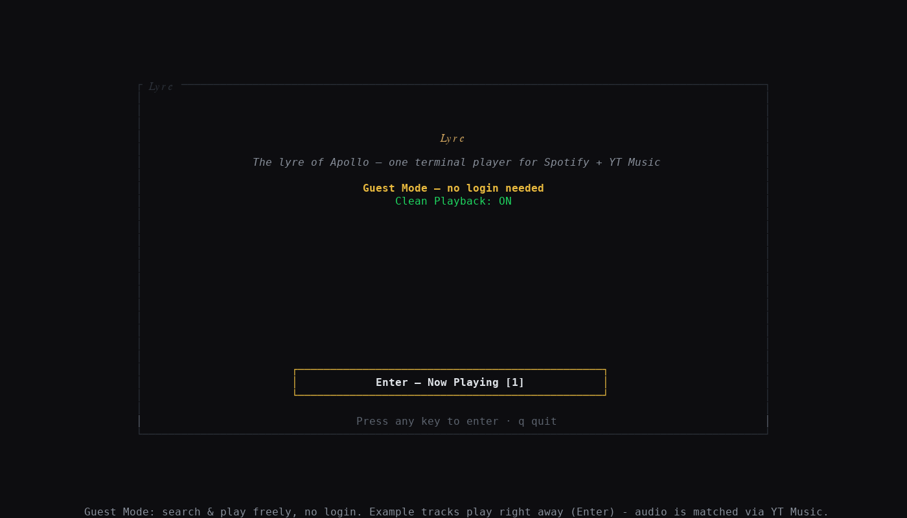
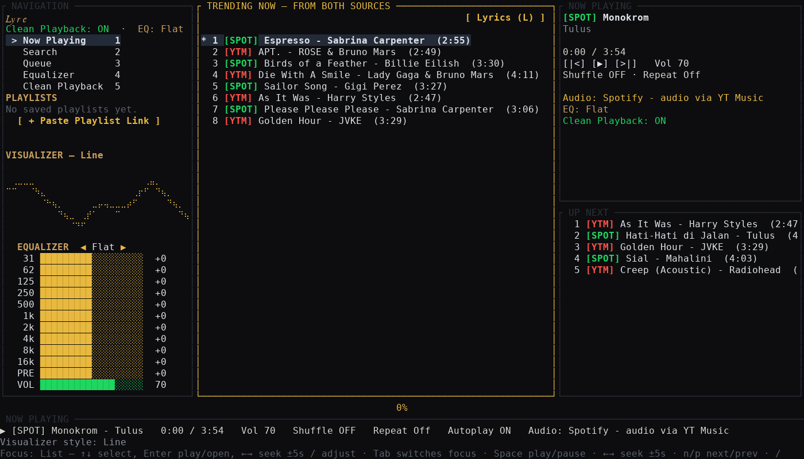
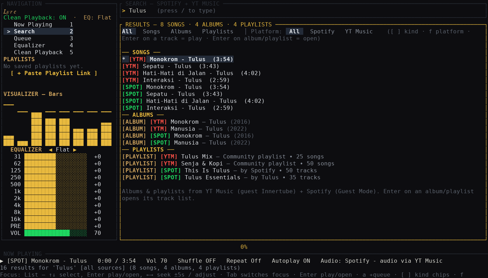
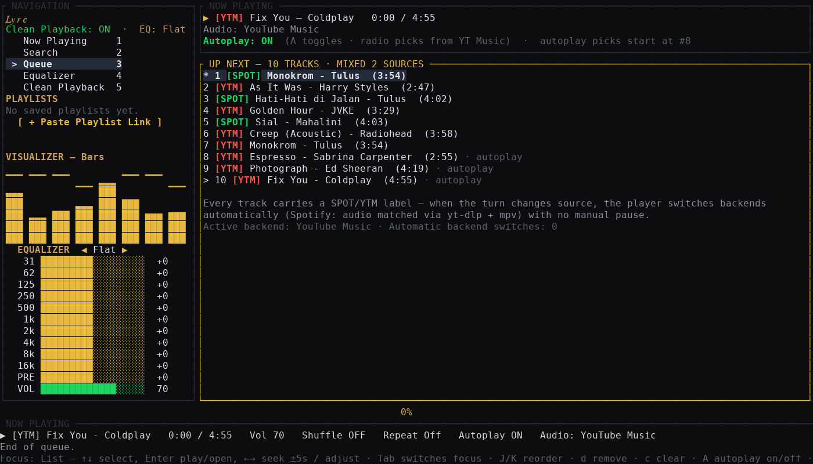
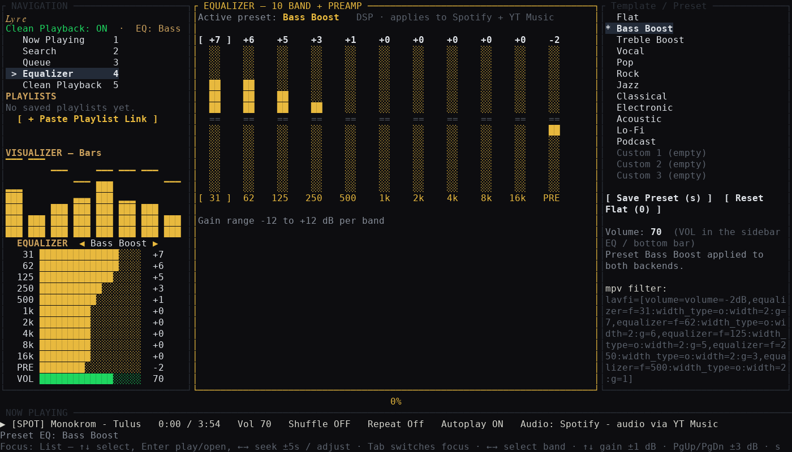
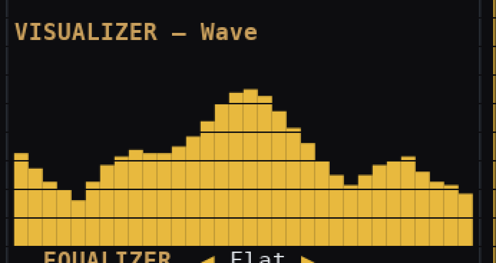

# Lyre

> **Bahasa Indonesia:** [README.id.md](README.id.md)


**Lyre is a guest-mode TUI music player for Spotify + YouTube Music. No account, no login, no setup wizard — just search and play.**

One terminal player over both catalogs: a unified guest search with kind and
platform filters, trending music on the home screen, playlists added by pasting
a share link, a mixed queue with built-in autoplay, synced lyrics, a 10-band
equalizer, Clean Playback, and a live audio visualizer — all keyboard- and
mouse-friendly, all in a single Rust binary.

## About

Lyre is a terminal music player (TUI) written in Rust with
[Ratatui](https://ratatui.rs) + crossterm. It treats Spotify and YouTube Music
as two catalogs of one library. You search both at once (or filter to one),
open albums and public playlists, queue songs from either source in any order,
and Lyre switches backends automatically as the queue crosses sources.

Playback works like this: YouTube Music tracks are streamed directly —
`yt-dlp` resolves the audio stream and `mpv` plays it. Spotify tracks are
matched by metadata: Lyre takes the title and artist from Spotify's catalog and
finds the same recording on YouTube Music (the model popularized by Spotube),
then plays that audio through the same yt-dlp + mpv path. The Now Playing bar
says so, honestly: `Spotify - audio via YT Music`. Because the audio never comes
from Spotify's servers, there is **no Premium requirement and no account
requirement anywhere in Lyre** — it runs entirely in guest mode.

## Philosophy

- **Named after Apollo's lyre.** In Greek myth the lyre is the instrument of
  Apollo, god of music and poetry — a small, precise instrument that carries
  far. Lyre the app aims for the same proportion: one focused tool, no bloat,
  that puts two of the world's largest music catalogs at your fingertips.
- **Your music, without accounts or walled gardens.** Lyre deliberately has
  no login. Playback never needed one, so there is nothing to sign up for,
  no developer keys to register, no tokens of yours to store. Discovery
  replaces the account library: search finds public playlists, and a pasted
  share link pins the ones you care about in your sidebar.
- **Honest data, always labeled.** Every track carries its source —
  `[SPOT]` or `[YTM]` — and every fallback is labeled too: Spotify audio is
  announced as "audio via YT Music", the offline starter list is labeled
  EXAMPLE TRACKS, and a rate-limited source shows its real retry time instead
  of silently inventing results. If a source fails, the UI names the step
  that failed; Lyre never fabricates data.
- **Terminal craft.** The interface is built to be driven by keyboard first
  (with full mouse support when you want it), drawn with restraint: no emoji,
  a serif-italic text wordmark, one gold accent palette, and a footer that
  always tells you which keys apply right now.
- **Local-first.** Settings, caches, and logs live in one config directory on
  your machine. The only token Lyre ever holds is Spotify's *anonymous*
  web-player token, kept in memory only — its expiry, never the token itself,
  is all that touches disk.

## Features

- **Unified guest search** across Spotify + YouTube Music — songs, albums,
  and public playlists in one list, with **kind chips** (All / Songs /
  Albums / Playlists, keys `[` `]`) and a **platform filter**
  (All / Spotify / YT Music, key `f`) that genuinely routes fetching: a
  disabled source is never called.
- **Trending home screen** — a merged, interleaved chart from YouTube Music
  (guest Innertube charts) and Spotify's public Top 50 Global playlist,
  disk-cached with its fetch time.
- **Playlists from share links** — paste a Spotify or YouTube Music playlist
  (or Spotify album) link and it opens under its real name and stays
  **pinned in the sidebar**.
- **Mixed queue with autoplay** — queue tracks from both sources in any
  order; with Autoplay on (default, key `A`) the queue refills itself with
  YouTube Music radio picks based on the song actually playing, labeled
  `· autoplay`. Your own picks always insert ahead of the autoplay block.
- **Synced lyrics** from LRCLib (key `L`) that replace the trending box in
  place, follow the playing track, and accept a ± timing offset (`+` / `-`).
- **10-band equalizer** — 31 Hz–16 kHz + preamp, −12…+12 dB, 12 presets
  (Flat, Bass Boost, Treble Boost, Vocal, Pop, Rock, Jazz, Classical,
  Electronic, Acoustic, Lo-Fi, Podcast) plus Custom 1/2/3 save slots,
  applied to playback as a real mpv `lavfi` filter chain. A compact EQ +
  volume lives in the sidebar too.
- **Clean Playback** — on YouTube Music, streams come straight from yt-dlp
  and SponsorBlock cuts sponsor / non-music segments; on Spotify, ad-type
  queue items are muted and skipped.
- **Five visualizer templates** via [cava](https://github.com/karlstav/cava) —
  Bars, Mirror, Wave, Line (braille), and LED — cycled with `V` or a click,
  double-smoothed so the motion feels analogue, not jittery.
- **Mouse support everywhere** — click to select, double-click to play/open,
  click the progress bar to seek, drag EQ and volume rows; forms are modal
  and `Esc` always gets you out.
- **Full-English UI**, splash title card, and diagnostics built in:
  `lyre doctor` and `lyre resolve-test`.

## Screenshots

Rendered from real runs of the v0.1.7 binary against local stub backends
(public-catalog fixture data; no personal data).

**Splash** — the serif-italic wordmark as a centered title card:



**Home** — trending from both sources, the Line (braille) visualizer and the
sidebar EQ underneath:



**Search** — one query, both catalogs: songs, albums, and playlists with
`[SPOT]` / `[YTM]` badges and the kind + platform filters:



**Queue** — a mixed two-source queue; autoplay picks are labeled and the
header marks where they start:



**Equalizer** — the Bass Boost preset across 10 bands + preamp, with the
actual mpv filter chain it produces:



**Visualizer** — the Wave template (filled skyline), one of five, up close:



## Installation

Lyre needs three runtime tools — **mpv**, **yt-dlp**, and **cava** — plus a
Rust toolchain to build. The bundled script installs the runtime tools for
you on Fedora, Debian/Ubuntu, and Arch:

```bash
./scripts/install-deps.sh
```

…or press `i` inside the app and Lyre runs the same install in your real
terminal. Manual commands, per distro:

### Fedora

```bash
sudo dnf install mpv yt-dlp cava
curl --proto '=https' --tlsv1.2 -sSf https://sh.rustup.rs | sh   # Rust, if needed
```

### Debian / Ubuntu

```bash
sudo apt install mpv yt-dlp cava
curl --proto '=https' --tlsv1.2 -sSf https://sh.rustup.rs | sh   # Rust, if needed
```

### Arch

```bash
sudo pacman -S mpv yt-dlp cava
curl --proto '=https' --tlsv1.2 -sSf https://sh.rustup.rs | sh   # Rust, if needed
```

### Build from source

```bash
git clone https://github.com/FathirThoriq/Lyre.git
cd Lyre
cargo build --release
./target/release/lyre           # launch the TUI
./target/release/lyre doctor    # dependency + guest-source checklist
```

### Launcher and shell setup (`lyr`)

For a permanent, user-level install (no sudo), run:

```bash
./scripts/install-launcher.sh
```

It copies the binary to `~/.local/bin/lyre`, creates a `~/.local/bin/lyr`
symlink, and — for each shell present on your machine — appends **one**
clearly marked, idempotent block to its rc file. Re-running replaces the
block; it never duplicates. This is exactly what the script writes:

**bash** — `~/.bashrc` (and the same for **zsh** — `~/.zshrc`):

```bash
# >>> lyre >>>
export PATH="$HOME/.local/bin:$PATH"
alias lyr='lyre'
# <<< lyre <<<
```

**fish** — `~/.config/fish/config.fish`:

```fish
# >>> lyre >>>
set -gx PATH $HOME/.local/bin $PATH
alias lyr lyre
# <<< lyre <<<
```

Prefer to do it by hand? Add `~/.local/bin` to your PATH in your shell's
own syntax (the blocks above) and call the binary `lyre` — the `lyr`
shortcut is just an alias plus the symlink.

Remove everything the launcher installed (blocks + both binaries) with:

```bash
./scripts/install-launcher.sh --uninstall
```

Then open a new terminal and run `lyre` — or simply `lyr`.

### Windows

No prebuilt `lyre.exe` is published — honest note: the binary is built and
verified on Linux, and a Windows build must be made on a real Windows
machine. The code itself is cross-platform (Ratatui + crossterm, paths via
the `dirs` crate, no Unix-only APIs). On Windows 10/11 with Windows
Terminal:

```powershell
# 1. Install Rust from https://rustup.rs (MSVC toolchain), then:
# 2. Runtime dependencies (or run .\scripts\install-deps.ps1):
winget install yt-dlp.yt-dlp
winget install mpv-player.mpv

# 3. Build and run:
cargo build --release
.\target\release\lyre.exe
```

One Windows caveat: the visualizer is powered by **cava, which is a
Linux/macOS tool**. On Windows the visualizer box shows its "unavailable"
hint and everything else — search, playback, EQ, lyrics, queue — works
unchanged. Settings live in `%APPDATA%\Lyre\` (see below).

## Usage

Launch with `lyre` (or `lyr` after the launcher install). Any key leaves
the splash. Lyre has **five screens**, visible in the sidebar at all times:

1. **Now Playing** — trending (or lyrics) box + the now-playing card
2. **Search** — one search over both catalogs
3. **Queue** — the mixed queue and the autoplay block
4. **Equalizer** — 10 bands + preamp, presets, custom slots
5. **Clean Playback** — the ad/sponsor switches

`Tab` cycles panel focus (Navigation → List → Sidebar EQ → Now Playing
bar); the footer always states the current focus and its keys.

### Keybindings

| Key | Action |
| --- | --- |
| `1`–`5` | Switch screen (Now Playing, Search, Queue, Equalizer, Clean Playback) |
| `Tab` / `Shift+Tab` | Cycle panel focus (footer shows the focus + its keys) |
| `q` | Quit |
| `Space` | Play / pause (on Clean Playback with List focus: toggle the switch) |
| `Enter` | Play the selected track / open the selected album or playlist |
| `n` / `p` | Next / previous track |
| `/` | Go to Search and focus the input |
| `[` / `]` | Search: cycle the kind chip (All / Songs / Albums / Playlists) |
| `f` | Search: cycle the platform filter (All / Spotify / YT Music), re-runs the search |
| `a` | Add to queue (inserts before the autoplay block) |
| `A` | Toggle Autoplay on/off |
| `L` | Toggle synced lyrics in the trending box |
| `+` / `-` | Lyrics offset ±0.5 s while lyrics are shown, otherwise volume |
| `,` / `.` | Lyrics offset −/+ elsewhere; previous / next EQ preset on the Equalizer screen |
| `v` | Toggle the sidebar visualizer |
| `V` | Cycle the visualizer template (Bars / Mirror / Wave / Line / LED) |
| `e` | Go to Equalizer (alias of `4`) |
| `s` | Shuffle (Now Playing / Queue) / save EQ preset (Equalizer) |
| `r` | Cycle repeat mode (Off / All / One) |
| `0` | Reset EQ to Flat (Equalizer) |
| `d` | Remove the selected queue item (Queue) |
| `c` | Clear the queue (Queue) |
| `J` / `K` | Move the selected queue item down / up (Queue) |
| `PgUp` / `PgDn` | EQ gain ±3 dB (Equalizer) |
| `x` | Delete the pinned playlist under the marker (Navigation focus) |
| `i` | Install missing dependencies (mpv / yt-dlp / cava) in the real terminal |
| `Ctrl+V` | Paste a full URL into the paste-link form (bracketed paste works anywhere — pasting a link opens the form pre-filled) |
| `Esc` | Close the form → back out of an opened playlist/album → focus back to Navigation. Always unwinds |
| Arrows | Act on the focused panel. In lists: move the selection. In the sidebar EQ: pick a row / adjust it. Almost everywhere else: `←` / `→` seek −5 s / +5 s |
| Mouse | Click nav items, sidebar playlists and the paste-link entry, EQ rows (drag to set), track rows (double-click = play), the progress bar (click = seek), search chips. Suspended while the modal form is open |

### Everyday flows

- **Search and filter.** Press `/`, type, `Enter`. Narrow with the kind
  chips (`[` `]`) or restrict to one platform with `f` — changing either
  re-runs the search, and a disabled platform is never contacted.
- **Playlists from a share link.** Click (or navigate to)
  **[ + Paste Playlist Link ]** in the sidebar and paste a Spotify
  playlist/album URL (`open.spotify.com/playlist/…`, `/album/…`) or a
  YouTube Music playlist URL (`music.youtube.com/playlist?list=…`). It
  opens under its real name and stays pinned in the sidebar; `x` removes
  a pinned entry. (Short `spotify.link` URLs are rejected with a hint —
  Lyre does not follow shorteners.)
- **Autoplay.** On by default. When fewer than 3 tracks remain after the
  playing one, Lyre appends up to 10 radio picks of the playing song,
  deduplicated against the queue and this session's history. Picks are
  labeled `· autoplay`; your manual picks always jump the queue ahead of
  them, and starting a different track by hand re-seeds the radio from
  the new song.
- **Settings and logs.** Everything lives in the config dir —
  Linux: `~/.config/lyre/`, Windows: `%APPDATA%\Lyre\`:
  - `settings.json` — EQ, volume, Clean Playback switches, autoplay and
    visualizer toggles + template, and your pinned `saved_playlists`
  - `lyre.log` — playback events and error details (tokens are never logged)
  - `trending_cache.json`, `spotify_trending_cache.json` — trending caches
  - `spotify_state.json` — Spotify rate-limit cooldown + the anonymous
    token's *expiry* (never the token itself)
  - `cava.conf` — the generated visualizer config, rewritten on spawn
- **Diagnostics.** `lyre doctor` prints a checklist (mpv / yt-dlp / cava
  and versions, config dir, which Spotify guest step works, Innertube and
  LRCLib reachability, any active rate-limit cooldown with its retry
  time). `lyre resolve-test "Tulus - Monokrom"` runs one track through
  the real yt-dlp resolve path and prints the matched title + stream host.

## How it works

- **YouTube Music data** — guest calls to YouTube's **Innertube** API
  (`music.youtube.com/youtubei/v1`, WEB_REMIX context, the ytmusicapi
  request shape) with **no Authorization header at all**: search,
  charts, album/playlist browse, and the `next` radio behind autoplay.
- **Spotify data** — catalog reads (search, albums, public playlists,
  Top 50) use Spotify's own **anonymous web-player token**: fetched from
  the public embed token endpoint, with a fallback that extracts the
  token embedded in a public embed page — the same mechanism the official
  web player uses for logged-out browsing. No Client ID, no secret.
- **Spotify rate-limit discipline** — the anonymous token has a real
  quota. All Spotify API calls pass through one choke point (≥ 1 s
  apart); an HTTP 429 starts a persisted global cooldown that honors
  `Retry-After`, during which Lyre makes **no** Spotify calls and shows
  `Spotify rate limited — retry at HH:MM:SS`. Call volume is kept low:
  one combined search request, trending from a 6-hour disk cache,
  single-page browses, per-session search caching.
- **Audio** — `yt-dlp` resolves the stream (directly for YouTube Music
  tracks; by "Artist - Title" match for Spotify tracks), `mpv` plays it,
  and position / pause / end-of-track come from **mpv's IPC socket** —
  which is also what makes the queue auto-advance and lyrics stay in sync.
- **Lyrics** — synced lyrics from [LRCLib](https://lrclib.net), bound to
  the playing track's identity so a track change can never show stale lines.
- **Visualizer** — Lyre spawns **cava** with a generated raw-output
  config and renders its actual frames (the system's audio output —
  in practice, mpv). No cava, no fake motion: the box shows a hint instead.

## Troubleshooting

- **"Spotify rate limited — retry at HH:MM:SS"** — Spotify's anonymous
  quota for your connection is exhausted; the note is the real
  `Retry-After` from Spotify's 429 response. Lyre stops calling Spotify
  until that moment (even across restarts) and everything else — YouTube
  Music, playback, the queue — keeps working. Searching again after the
  retry time costs exactly one probe call.
- **Visualizer says cava is missing / unavailable** — install it with
  `./scripts/install-deps.sh` or press `i` in the app. On Windows this
  is expected (cava is Linux/macOS only); the rest of Lyre is unaffected.
- **YouTube answers "Sign in to confirm you're not a bot"** — that is
  YouTube's bot check on the stream-resolve step, typically triggered
  from datacenter/VPN IPs. Residential connections normally pass. Lyre
  surfaces yt-dlp's message verbatim in the UI and in `lyre.log`.
- **The wordmark shows as boxes (tofu)** — the splash/sidebar wordmark
  "𝐿𝑦𝑟𝑒" uses Mathematical Italic Unicode letters. Most modern
  terminals render them via font fallback (e.g. Noto Sans Math); if
  yours shows boxes, install a font that covers the Mathematical
  Alphanumeric Symbols block. Everything else is plain ASCII + box
  drawing and renders anywhere.
- **Something else misbehaves** — run `lyre doctor`, then check
  `lyre.log` in the config dir; errors there name the failing step
  (token / embed / api for Spotify, Google's `reason`/`message` for
  YouTube Music).

## License

[MIT](LICENSE) © 2026 Fathir Thoriq
